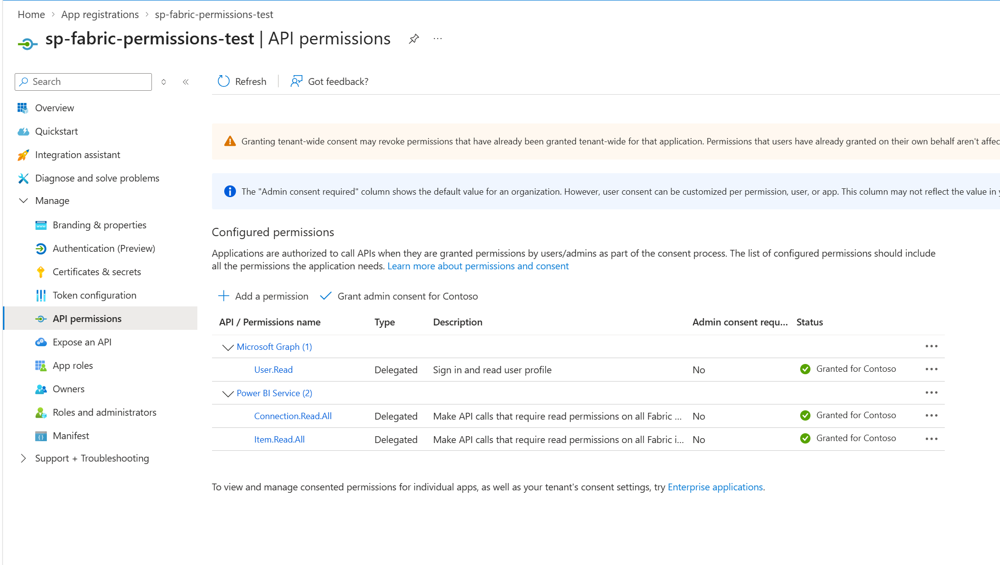
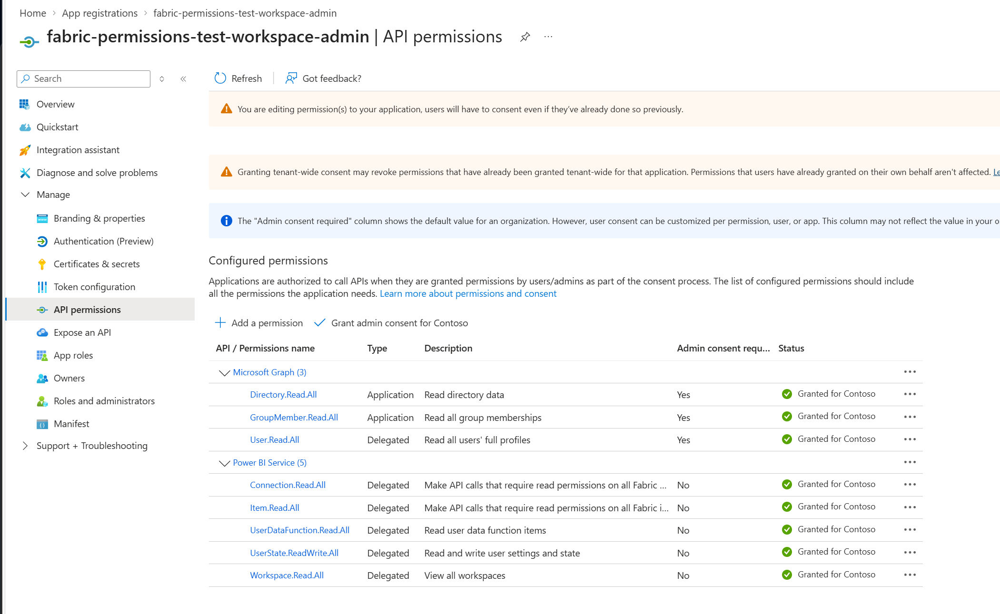
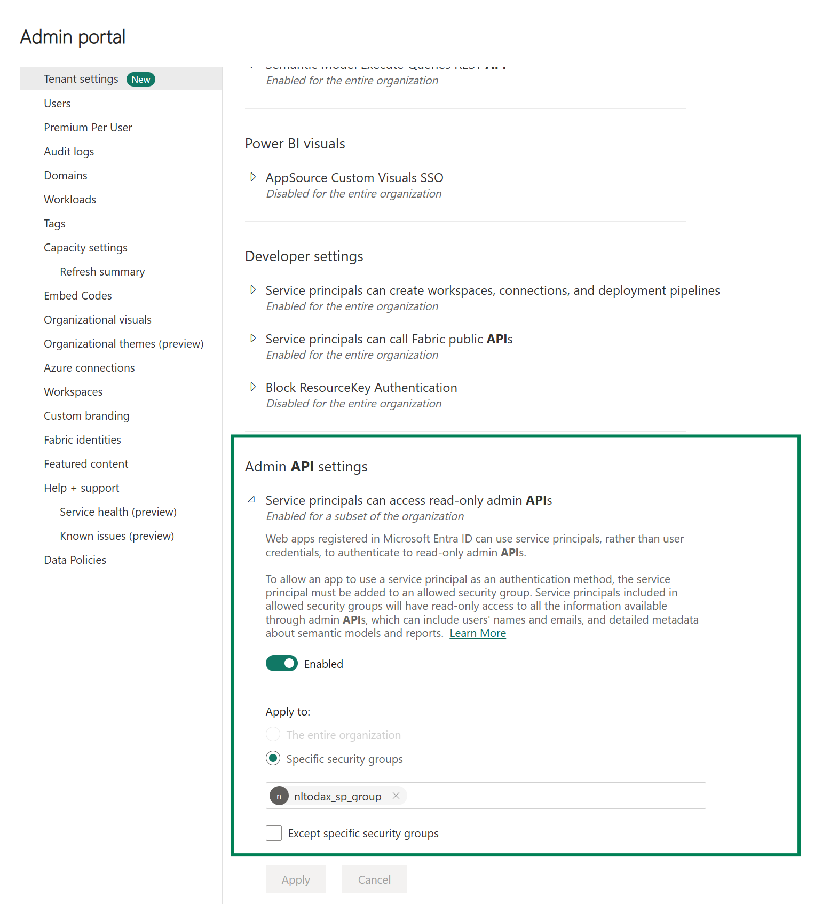
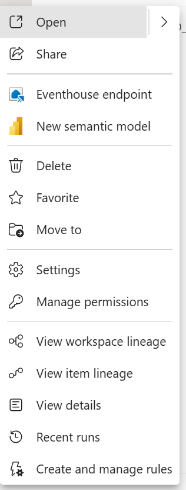
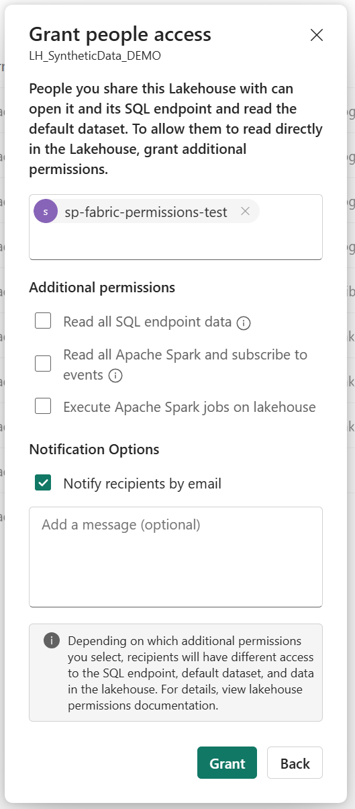
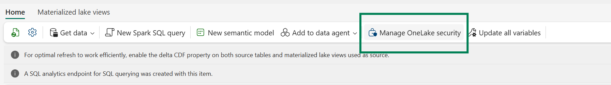
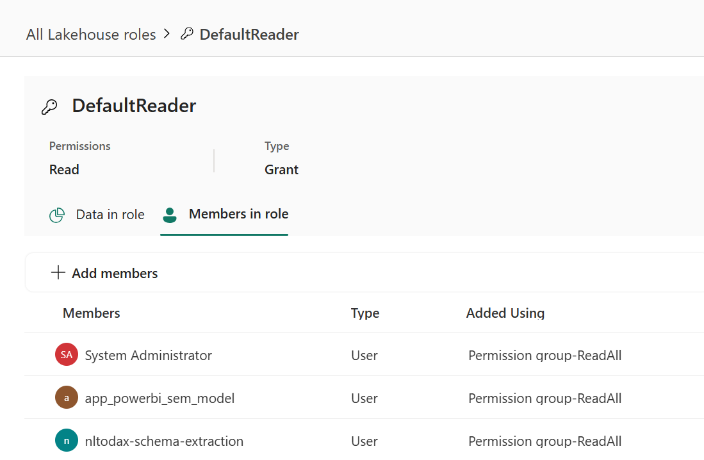
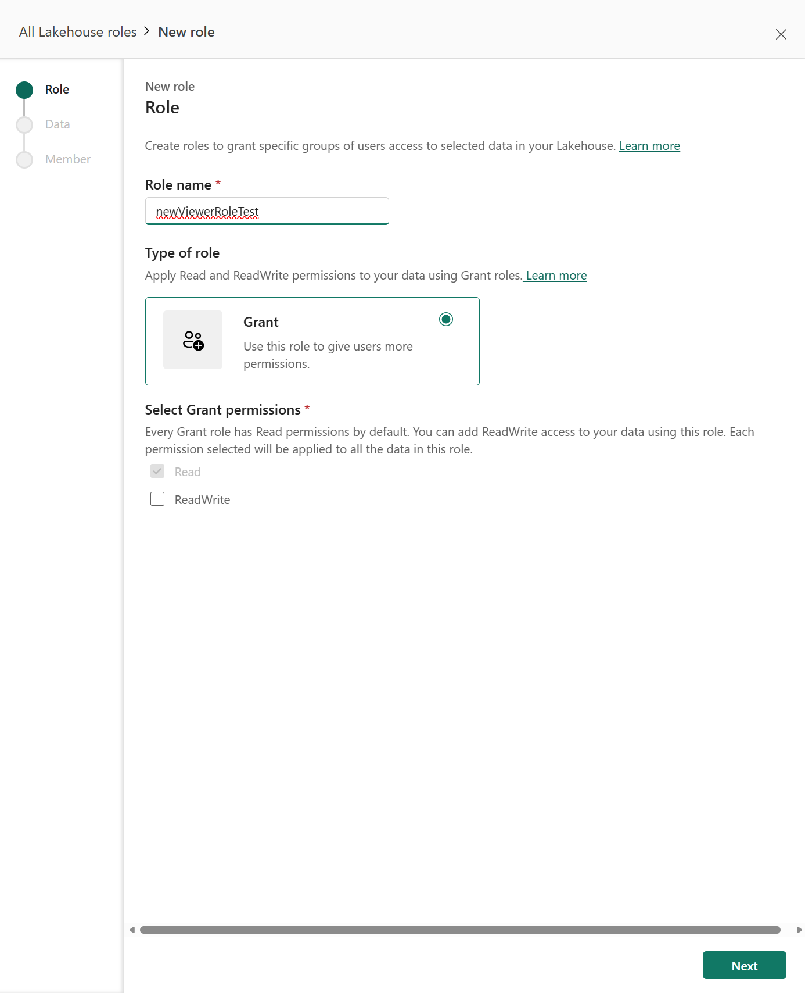

# Setup Guide

This guide matches the in-app **Setup Guide** page. It describes the least-privilege configuration required to audit item access and validate SQL and OneLake ABFS data paths.

## 1. Configure API Access

The app uses two service principals:

- **Test service principal**: used for SQL endpoint and OneLake ABFS data checks.
- **Admin service principal**: used for workspace discovery, Entra identity resolution, and direct-access auditing.

### Test Service Principal

Create a service principal for testing purposes with the required Fabric API permissions. This setup is completed in the Azure portal.



### Admin Service Principal

Create an Admin service principal for auditing user permissions with the required API permissions. This setup is completed in the Azure portal.



Ensure the Admin SP is added to a security group allowed to access read-only Admin APIs. Configure this in Fabric Admin Portal permissions.



## 2. Grant Direct Item Access

**Control plane permissions**

For least-privilege permissions, ensure no workspace role is given to the user.

Right-click the respective Lakehouse and open **Manage permissions > Add user**.



Grant the test user **Read** access on the Lakehouse. Do not select any other boxes when aiming for a least-privilege setup.



## 3. Configure OneLake ABFS Access

**Data plane permissions**

Direct OneLake ABFS validation uses the test service principal's OneLake security role and data scope.

Open OneLake security for the Lakehouse.



Review the automatic DefaultReader role assignment before testing restricted access. Make sure the restricted user is not assigned to this role.



Create a new, restricted role.



Restrict data scope for the new role.

.png)

Add the test identity as a member in the new role.

.png)

Item Read access alone does not grant access to every OneLake table path.

## 4. Configure SQL Permissions

**Data plane permissions**

SQL endpoint visibility and query behavior are controlled by the Lakehouse SQL analytics endpoint mode and SQL security grants. Replace every placeholder in the following examples before running them.

### Grant Table Permissions

```sql
GRANT SELECT ON OBJECT::[<schema>].[<table>]
TO [<user-or-service-principal>];
GO
```

### Apply Row-Level Security

```sql
CREATE SCHEMA Security;
GO

CREATE FUNCTION Security.fn_FilterRows (@Region nvarchar(100))
RETURNS TABLE
WITH SCHEMABINDING
AS
RETURN SELECT 1 AS AllowedRow
WHERE @Region = N'<allowed-region>'
  AND USER_NAME() = N'<user-or-service-principal>';
GO

CREATE SECURITY POLICY Security.RowFilterPolicy
ADD FILTER PREDICATE Security.fn_FilterRows([<column>])
ON [<schema>].[<table>]
WITH (STATE = ON);
GO
```

### Apply Column-Level Security

```sql
REVOKE SELECT ON OBJECT::[<schema>].[<table>]
FROM [<user-or-service-principal>];
GO

GRANT SELECT ON OBJECT::[<schema>].[<table>]
([<column-1>], [<column-2>])
TO [<user-or-service-principal>];
GO
```

The SQL endpoint and OneLake ABFS validation paths are separate. Validate both after changing permissions.
